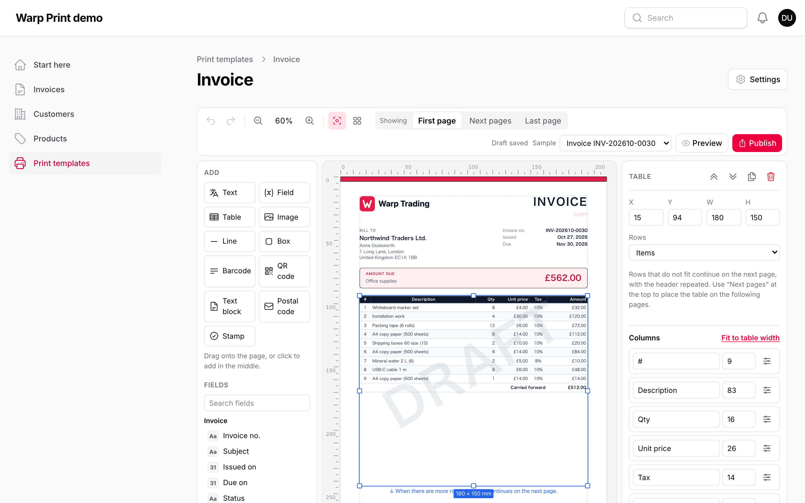
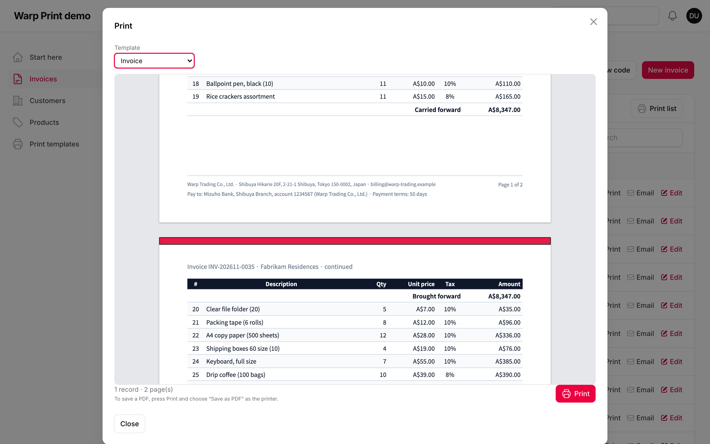
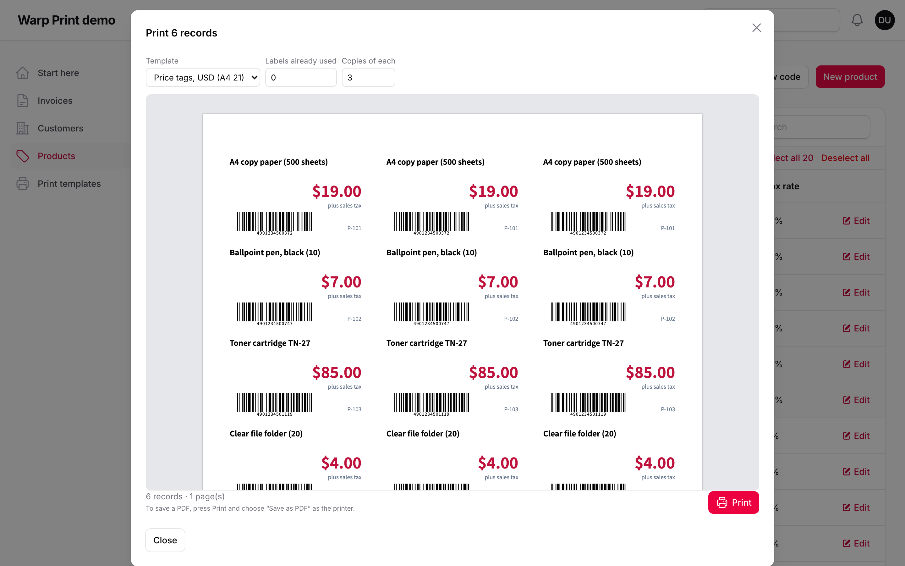
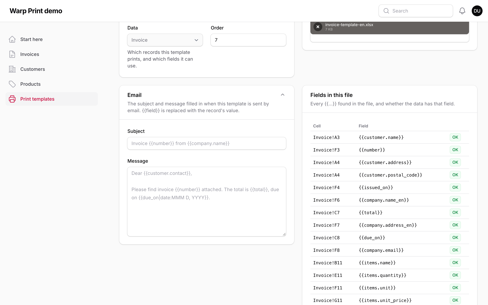

# Warp Print



**Let your admins design invoices, delivery notes, price tags and address labels inside Filament — and print them from any record exactly as previewed. Long item tables continue over pages with carried totals, PDFs come from the same page, and the Excel forms your office already uses are filled in place.**

<a href="https://demo.warpui.com/print"></a>

Print an invoice of four pages, change its template in the designer, print price tags with barcodes and fill an Excel invoice at **[demo.warpui.com/print](https://demo.warpui.com/print)**. No sign-up needed; the data is reset every hour.

Most Filament PDF plugins render a Blade view with dompdf: someone has to edit the view for every change of layout, item tables do not continue cleanly onto a second page, and fonts and Japanese text are a struggle. Warp Print turns this around. You, the developer, write a small `PrintSource` class that says **which fields** a template may use. Your admins **design the page** in the panel: drag fields, a logo and the item table onto an A4 sheet, publish, done. When someone presses Print on an invoice, they see the real pages in a preview, and the preview is what prints — the designer, the print preview and the server PDF are drawn by the same renderer.

```php
use Qalainau\FilamentWarpPrint\Actions\PrintAction;

public static function table(Table $table): Table
{
    return $table
        ->columns([/* ... */])
        ->recordActions([
            PrintAction::make(), // a "Print" button on every invoice
        ]);
}
```

## Contents

- [Features](#features)
- [Requirements](#requirements)
- [Installation](#installation)
- [Getting started](#getting-started)
- [Sources and fields](#sources-and-fields)
- [Print buttons](#print-buttons)
- [The designer](#the-designer)
- [Starter templates](#starter-templates)
- [Item tables over several pages](#item-tables-over-several-pages)
- [Text, fields and formats](#text-fields-and-formats)
- [Calculated fields and conditional styles](#calculated-fields-and-conditional-styles)
- [Copies and watermarks](#copies-and-watermarks)
- [Text blocks](#text-blocks)
- [Postcards, envelopes and stamps](#postcards-envelopes-and-stamps)
- [Labels](#labels)
- [Excel forms](#excel-forms)
- [Printing a list](#printing-a-list)
- [PDF files on the server](#pdf-files-on-the-server)
- [Sending by email](#sending-by-email)
- [Large batches in the background](#large-batches-in-the-background)
- [Issued documents (electronic bookkeeping)](#issued-documents-electronic-bookkeeping)
- [Print log and reprints](#print-log-and-reprints)
- [Using it from code](#using-it-from-code)
- [Moving templates between environments](#moving-templates-between-environments)
- [Approvals with Warp Flow](#approvals-with-warp-flow)
- [Multi-tenancy](#multi-tenancy)
- [Remote images and SSRF](#remote-images-and-ssrf)
- [Fonts](#fonts)
- [Configuration](#configuration)
- [Security](#security)
- [Translations](#translations)
- [Limitations](#limitations)
- [Troubleshooting](#troubleshooting)

## Features

- **A designer in the panel.** Text, fields, the item table, images (logo, company seal), lines, boxes, Code 128 and EAN-13 / JAN barcodes and QR codes, placed in millimetres on the real paper size. Rulers, grid, snapping to other elements with guides, alignment, undo and redo, keyboard nudging.
- **Drafts and versions.** Every change is saved as a draft right away; printing uses the published version until an admin publishes the draft. Earlier versions can be opened again. Two admins editing the same template are warned instead of overwriting each other.
- **Item tables over many pages.** The heading row repeats on every page, the total can be carried to the next page (*Carried forward / Brought forward*), each page can have a subtotal, empty ruled rows can fill the form, and the last page can be shorter so the table ends above the totals. Elements can appear on the first page only, on the last page, on every page but the first, and so on, or move up under the last row.
- **What you see is what prints.** The print window shows the actual pages. Printing uses the browser's own print dialog (which also saves PDFs), so nothing has to be installed on the server.
- **Server PDFs when you need them** — to attach to an email or to save many at once — through Chrome ([Browsershot](https://github.com/spatie/browsershot)) or [Gotenberg](https://gotenberg.dev), drawing exactly the same page.
- **Your Excel forms.** Upload the `.xlsx` invoice your office already has and write `{{customer.name}}` in its cells. The item row is repeated for every item — first into the empty ruled rows below it, then by adding rows — and merged cells, formulas such as `SUM()`, images, conditional formats and the print area move along. Formatting is never touched.
- **Labels.** Address labels, price tags and name badges on any sheet (A4 24, A4 21, Letter 30, … or your own sizes). Skip the labels already used on a sheet and print several copies of each.
- **Print the list itself.** `PrintTableAction` prints a Filament table as it is filtered, searched and sorted, with the heading on every page.
- **Made for real forms.** Japanese era dates (令和8年10月22日), currencies in their own decimals, tax per rate, vertical text, company seals, "shrink to fit" for long names, and a *Reprint* / 再発行 mark that appears from the second print of the same record.
- **Start from a ready-made template.** Invoice, quote, delivery note and receipt (in Japanese and English), address labels, price tags, a postcard and a Naga 3 envelope. Their fields are matched to your data when they are created.
- **Send by email.** `EmailPrintAction` attaches the PDF (or the Excel file) and sends it to the record's own recipients, with a subject and message that the template fills in. `EmailPrintBulkAction` sends a month of invoices, each to its own customer, in the background.
- **Copies and watermarks.** Print an *original* and a *copy* (控え) of every record in one go, and put *COPY*, *DRAFT* or *PAID* across the page — always, from the second copy, on reprints, on test prints or when a field matches.
- **Calculated fields and conditional styles.** Admins write small formulas (`total - paid`, `sum(items.amount)`, `addDays(issued_on, 30)`) without touching your code, and make a value red when it is negative or bold when it is over a limit.
- **Text blocks.** Terms and conditions with headings, bold text and lists, continuing onto extra pages when they are long.
- **Postcards and envelopes.** Postal codes in the printed boxes of a Japanese postcard, vertical addresses with kanji numbers, and red name and date stamps for approval boxes.
- **Large batches in the background.** More records than fit in the print window are made by a queued job — one PDF, one PDF per record or Excel files in a ZIP — and the user gets a notification with the download.
- **Issued documents kept unchanged.** Every PDF the server makes for an invoice can be stored with its hash, searchable by date, amount and counterparty, as Japan's electronic bookkeeping law (電子帳簿保存法) asks; printing the same invoice again gives exactly the same PDF.
- **Templates move between environments.** Export them as JSON and import them in another panel, tenant or server (`php artisan warp-print:import` in your deploy).
- **Approvals from [Warp Flow](https://warpui.com/flow).** Show who approved a purchase order and when, as red stamps, and print only approved records.
- **Safe for admins to edit.** Templates can only show the fields you list in a `PrintSource`. They cannot run code, read other columns or follow other relations.

## Requirements

- PHP 8.3+ with the `zip` and `dom` extensions
- Laravel 12 or 13
- Filament 5
- SQLite, MySQL 8, MariaDB 10.11+ or PostgreSQL
- For PDF files made on the server (optional): Node and Chrome for Browsershot, or a Gotenberg container

## Installation

> **Warp Print is a commercial plugin.** A license is required. After purchase you receive credentials for the private Composer repository.

Add the repository and authenticate:

```bash
composer config repositories.qalainau composer https://qalainau.privato.pub/composer
composer config --auth http-basic.qalainau.privato.pub "your-email" "your-license-key"
```

This writes your license key to `auth.json` in the project. Add `auth.json` to `.gitignore`, and on CI or servers pass the credentials in the `COMPOSER_AUTH` environment variable instead.

Install the package, run the migration and publish Filament's assets:

```bash
composer require qalainau/filament-warp-print
php artisan migrate
php artisan filament:assets
```

The migration creates three tables: `warp_print_templates`, `warp_print_template_versions` (published versions) and `warp_print_logs` (who printed which record, when, and how). Your tables are not changed. To edit the migration, publish it with `php artisan vendor:publish --tag=filament-warp-print-migrations`. Publish it before you run `php artisan migrate` for the first time: Warp Print then runs your copy instead of its own. If the tables already exist, change them with a migration of your own instead.

> Run `php artisan filament:assets` again after every update of the package.

## Getting started

**1. Describe what can be printed.** A source names a model and the fields a template may show:

```php
namespace App\Print;

use App\Models\Invoice;
use App\Models\InvoiceItem;
use Qalainau\FilamentWarpPrint\Sources\Field;
use Qalainau\FilamentWarpPrint\Sources\PrintSource;

class InvoiceSource extends PrintSource
{
    protected static string $model = Invoice::class;

    public function fields(): array
    {
        return [
            Field::text('number')->label('Invoice no.'),
            Field::date('issued_on'),
            Field::date('due_on'),
            Field::text('customer.name')->label('Customer'),
            Field::text('customer.address')->label('Address'),
            Field::image('company.logo')->state(fn () => 'logos/company.png'), // a path on the "public" disk
            Field::money('total', 'JPY')->state(fn (Invoice $invoice) => $invoice->total()),
            Field::table('items', [
                Field::text('name')->label('Item'),
                Field::number('quantity'),
                Field::money('unit_price', 'JPY'),
                Field::money('amount', 'JPY')->state(fn (InvoiceItem $item) => $item->quantity * $item->unit_price),
            ])->label('Items'),
        ];
    }

    public function title(\Illuminate\Database\Eloquent\Model $record): string
    {
        return 'Invoice '.$record->number; // used for file names
    }
}
```

**2. Register the plugin** with your sources. It adds the **Print templates** page to the panel:

```php
use App\Print\InvoiceSource;
use Qalainau\FilamentWarpPrint\WarpPrintPlugin;

public function panel(Panel $panel): Panel
{
    return $panel
        // ...
        ->plugin(WarpPrintPlugin::make()->sources([InvoiceSource::class]));
}
```

**3. Add a print button** to the invoices (see [Print buttons](#print-buttons)):

```php
->recordActions([PrintAction::make()])
```

**4. Design and publish.** Open *Print templates* → *New*, give it a name, choose *Invoice* as the data and *Document* as the kind, and pick the paper. The designer opens. Click *Items* in the field list to add the item table, add the customer's name and the total, then press **Publish**. The Print button on an invoice now offers this template.

## Sources and fields

A source is a plain class extending `PrintSource`. Everything a template can show is in `fields()`.

| Field | Shows | Default format |
| --- | --- | --- |
| `Field::text('path')` | Text. Enums show their label (`HasLabel`) | as is |
| `Field::number('path', decimals: 2)` | A number | thousands separator |
| `Field::money('path', 'EUR')` | An amount. Without a currency it uses [the record's currency](#sources-and-fields) (`PrintSource::currency()`) or `config('filament-warp-print.currency')` | currency symbol and its own decimals (¥1,234 / €1,234.50) |
| `Field::date('path')` / `Field::datetime('path')` | A date or a date and time | `YYYY/MM/DD` (`HH:mm`) |
| `Field::boolean('path')` | Yes / no | ✓ or empty |
| `Field::image('path')` | A logo, a seal or a product photo: a path on `->disk('public')` (default `config('filament-warp-print.image_disk')`), a `data:image/...` URI, or an http(s) URL when [remote images](#remote-images-and-ssrf) are allowed. `->directory('teams/1')` keeps paths inside one folder | — |
| `Field::table('path', [...])` | Item rows: a relation (`hasMany`, `belongsToMany`, …) or anything iterable from `state()`. The columns are fields read from each item | — |

**Paths** follow relations with dots (`customer.name`, and in a table `product.code`). The relations a source uses are eager loaded for you, also when many records are printed at once.

**Every field can be computed** with `->state(fn (Model $record) => ...)`; in a table column the closure receives the item. Use it for totals, tax per rate, your own company's details or anything that is not a column.

**Other options:** `->label('…')` is the name in the designer, `->group('Customer')` groups fields in the designer's list, `->sample('INV-0001')` is shown in the designer when there is no record yet.

**Dates and times** are passed to the page as the wall-clock time of the panel's timezone (`FilamentTimezone`, which defaults to `app.timezone`), so a browser in another timezone never prints the day before.

**Money in each record's currency.** When your invoices are in different currencies, return the record's currency from `currency()`. Every `Field::money()` without a currency of its own — also in item tables, totals and page subtotals — then uses it, in the designer's sample, the print window, server PDFs, Excel forms and email text:

```php
public function currency(Model $record): ?string
{
    return $record->currency; // 'GBP' → £562.00, 'JPY' → ¥3,431,094
}
```

- The currency is an ISO 4217 code (`GBP`, `usd` is read as `USD`). `null`, an empty string or anything that is not three letters falls back to `config('filament-warp-print.currency')`.
- A field with its own currency keeps it: `Field::money('fee', 'JPY')` is always in yen.
- A format chosen in the designer or in text wins over both: `{{total|money:EUR}}` is always in euros.
- Calculated fields of the `money` type made in the designer follow the record's currency too.
- Excel cells that hold only one field get the number itself, so the cell's own number format in your .xlsx decides how it looks.

A source can also limit what is printed and by whom:

```php
public function query(): Builder
{
    return parent::query()->where('status', '!=', 'cancelled'); // records outside this query are not printed
}

public function canPrint(Model $record, ?Authenticatable $user): bool
{
    return $user?->can('view', $record) ?? false; // the default checks the model policy's "view", if there is a policy
}

public function sampleRecord(): ?Model
{
    return $this->scopedQuery()->has('items', '>=', 3)->latest()->first(); // the designer's default sample
}
```

`query()` is where you add your own conditions. When Warp Print reads records it always uses `scopedQuery()`: your `query()` plus the current tenant (see [Multi-tenancy](#multi-tenancy)). Use `scopedQuery()` too when you override `sampleRecord()`, so the designer never shows another tenant's record.

Every template also has the **print** fields: *Printed on* (`print.date`), *Printed at* (`print.datetime`), *Printed by* (`print.user`), *Reprint* (`print.reprint`, true from the second print of the record with this template) and *Times printed* (`print.count`).

## Print buttons

### One record

```php
use Qalainau\FilamentWarpPrint\Actions\PrintAction;

// In a table row, or in the header of a view or edit page
PrintAction::make()

// Only one template, or a choice of some, in this order
PrintAction::make()->template('invoice')
PrintAction::make()->templates(['invoice', 'delivery-note'])

// When two sources share a model, say which one
PrintAction::make()->source(InvoiceSource::class)
```

The source is found from the record's model among the registered sources. The print window lists the **published** templates of that source (or the ones you name), shows the preview with the page count, and has **Print** (the browser's print dialog, which can also save a PDF), **Download PDF** (when a [PDF driver](#pdf-files-on-the-server) is set) and, for Excel templates, **Download Excel**.

It is an ordinary Filament action: `->label()`, `->icon()`, `->visible()`, `->authorize()` and the rest work as usual.

### Several records

```php
use Qalainau\FilamentWarpPrint\Actions\PrintBulkAction;

->toolbarActions([
    PrintBulkAction::make(),                                       // invoices: one document, every invoice from a new page
    PrintBulkAction::make()->template('address-labels')->label('Print labels'),
])
```

The records are printed in the order they were selected, each starting on a new page (labels fill the sheet). Excel templates download one file per record in a ZIP. Up to `batch_limit` records (default 200) are shown and printed in the window; with more, the window offers to [make them in the background](#large-batches-in-the-background) instead.

## The designer

Open **Print templates** in the panel. *New* asks for:

- **Name** and **key** — the key is what `->template('invoice')` refers to.
- **Data** — one of the registered sources. It decides the fields.
- **Kind** — *Document* (invoices, delivery notes, quotes), *Labels* (many records on a sheet) or *Excel form*.
- **Paper** and orientation (documents) or the label sheet (labels). Both can be changed later.



**Adding.** Click an element in *Add* to put it in the middle of the page, or drag it to a place. Click a field to add it as a field element (an image field becomes an image; *Items* becomes the item table), or drag it.

**Moving and sizing.** Drag elements; drag the handles to resize. Elements snap to the grid and to the edges and centres of the paper, the margins and other elements (the pink guides show it); hold **Alt** to move freely. Arrow keys move by 0.5 mm, with **Shift** by 5 mm. Select several with **Shift**-click or by dragging a box on an empty part of the page, then align or space them evenly.

**Keys.** **Ctrl/⌘ Z** undo, **Ctrl/⌘ Shift Z** or **Ctrl/⌘ Y** redo, **Ctrl/⌘ D** duplicate, **Ctrl/⌘ C / V** copy and paste, **Delete** remove, **Ctrl/⌘ A** select all, **Esc** deselect, **Ctrl/⌘ S** save now. Double-click a text to edit it.

**Settings.** With nothing selected, the panel on the right shows the paper, the margins (guide lines only), the template's default font and size, the grid and the published versions. With one element selected it shows its position and size in millimetres and everything about it: text and format, font, size, bold, alignment, colours, padding, borders (per side), rounded corners, vertical text, *shrink to fit*, the pages it is shown on and a condition.

**Showing.** *Show only when* hides an element unless a field has a value, is empty, is yes / no or equals a value. The sample *Reprint* mark is a text with *Show only when: Reprint — is yes*.

**Sample.** The designer shows real values from the newest record (choose another in *Sample*), or made-up values when there are none. **Preview** opens exactly the pages that would print, with the draft.

**Saving and publishing.** Changes are saved as a draft a moment after you make them ("Draft saved"). Printing keeps using the published version, so half-finished changes never reach your users. **Publish** makes the draft the version that prints; you can add a note ("New bank account"). *Published versions* lists them; *Open in draft* loads an earlier one into the draft (publish it to use it again).

If someone else saved the template after you opened it, the designer says so and lets you load their version or keep yours, instead of silently overwriting.

**Images.** Uploaded images (logos, seals) are stored in the template, scaled down to 1,600 px. Images that differ per record come from image fields. When [remote images](#remote-images-and-ssrf) are allowed, the inspector also has an *image URL* box: the URL is checked when you press **Use**, and a template with an image URL that is not allowed is not saved.

## Starter templates

Admins rarely want to start from a blank page. **From a starter** on the Print templates page offers ready-made templates:

| Starter | What is on it |
| --- | --- |
| 請求書 (invoice, Japanese) | A4. The qualified invoice registration number, tax per rate (10 % / 8 %), items that carry their total over pages, the company seal |
| 見積書 (quote, Japanese) | A4. The quote total, valid until, delivery and payment terms |
| 納品書 (delivery note, Japanese) | A4. No prices; the slip number as a barcode and a box for the receiver's stamp |
| 領収書 (receipt, Japanese) | A5 landscape. 但し書き, the amount before tax and the tax, a revenue stamp box, and an original plus a copy marked 控 |
| Invoice, Quote, Receipt (English) | A4 / A5. Logo, amount due, totals right under the items; terms on the quote continue onto a new page when they are long; a *PAID* watermark on the receipt |
| Address labels, Price tags | A4 24 and A4 21 sheets; price with an EAN-13 / JAN barcode |
| はがき (postcard), 長形 3 号 (Naga 3 envelope) | Postal code in the printed boxes, vertical address with kanji numbers, the name with 様 / 御中, the sender |

Choose a starter and the data. The starter's fields (`number`, `issued_on`, `customer.name`, `items.amount`, …) are **matched to your source's fields**: first by the same path, then by common names (`invoice_number`, `client.name`, `lines`, `qty`, …) and only with a fitting type (a date for `issued_on`, money for `total`). The template is created as a **draft** and opens in the designer. If some fields were not found, a notice lists them; the elements that use them are marked *Fields that are not in the data*, so the admin can pick the right ones before publishing.

When your field names differ, tell Warp Print how they match:

```php
class InvoiceSource extends PrintSource
{
    public function starterFields(): array
    {
        return [
            'number' => 'code',
            'issued_on' => 'invoice_date',
            'customer.name' => 'client.company_name',
            'items' => 'lines',              // the item table
            'items.amount' => 'line_total',  // a column of it
        ];
    }
}
```

From code: `WarpPrint::fromStarter('invoice-ja', InvoiceSource::class, name: '請求書', key: 'invoice')` returns the template and the fields that were not found.

## Item tables over several pages

The first table on a page (with *Rows that do not fit continue on the next page*) is the **flowing table**. When its rows do not fit:

- the rows continue on the next page, under the heading row again;
- with **Carry the total to the next page**, the columns marked *Add up* are totalled at the bottom of the page (*Carried forward*) and at the top of the next one (*Brought forward*);
- with **Subtotal on every page**, every page ends with the total of its own rows;
- with **Fill with empty rows**, the rest of the table is ruled with empty rows, as on a printed form;
- **Rows per page** stops a page at a fixed number of rows.

Use **Showing** at the top of the designer to place things per page:

| Showing | What you set there |
| --- | --- |
| **First page** | Everything, and the table's place on the first page |
| **Next pages** | Where the table is on page 2 onwards (usually higher and longer, under a small continuation header) |
| **Last page** | How tall the table may be on the last page, so it ends above the totals |

If the remaining rows fit on a page but not above the totals, Warp Print adds one more page for the last rows and the totals. If they all fit on the first page, the first page is the last page.

Each element has **Show on**: every page, the first page only, the last page only, every page but the first (for a continuation header such as "Invoice 1234 (continued)"), or every page but the last. **Move up under the table** puts an element (a totals box, a note) right under the last row on the last page instead of at a fixed place.

### Heading rows for groups of items

A monthly invoice usually lists its deliveries one after another, each under a heading with the delivery number and subject. In the table's **Rows** settings, choose a field of the items in **Heading row when this changes**. A row across the whole table is then added before the first item and wherever that field's value changes from the item above it.

- **Heading text** is the text of that row, with `{{fields}}` of the first item of the group: `Delivery {{sale_number}} — {{sale_subject}}`. Left empty, it shows the field itself. The fields are the item's own, as in a column's text (`{{sale_subject}}`, not `{{items.sale_subject}}`).
- The heading is bold on a light background; **Heading background** changes the colour.
- Items are not sorted: give the table its rows in group order (`->orderBy('sale_number')` on the relation, or sort in `state()`). A value that comes back later starts a new heading.
- A heading is never left alone at the bottom of a page: it moves to the next page with its first item. The heading row of the table is repeated on every page as usual; a group that continues on the next page carries on without a new heading.
- Headings are not items: row numbers (`#`), page subtotals and carried totals count the items only.
- They work in flowing tables, other tables on the page and tables on labels. Excel forms are filled row by row and have no heading rows.

```php
Field::table('items', [
    Field::text('sale_number'),
    Field::text('sale_subject'),
    Field::text('name'),
    Field::money('amount'),
])->state(fn (Invoice $invoice) => $invoice->items->sortBy(['sale_number', 'position'])->values()),
```

## Text, fields and formats

A **text** element is fixed text with fields in double braces:

```text
Invoice {{number}} — {{customer.name}}
Page {{page}} of {{pages}}
Due {{due_on|date:MMM D, YYYY}} · Total {{total|money:EUR}}
```

`{{page}}` and `{{pages}}` count the pages of each record. Choose fields from *Insert a field* instead of typing them.

A **field** element shows one value, with a **Format** chosen in the panel (and text before and after it).

| Format | Written as | Examples |
| --- | --- | --- |
| Number | `number`, `number:2` | 1,234 · 1,234.50 |
| Money | `money`, `money:USD` | ¥1,234 · $1,234.00. *Currency symbol* off: 1,234 |
| Date | `date:pattern` | see below |
| Yes / no | `boolean` | ✓ |
| Capitals | `upper` | ACME |

Date patterns: `YYYY` `YY` `MMMM` `MMM` `MM` `M` `DD` `D` `dddd` `ddd` `HH` `H` `hh` `h` `mm` `ss` `A`, Japanese eras `GGGG` (令和) `G` (R) `E` (8, or 元 for the first year) `EE` (08). Text in `[brackets]` is kept as is. For example `YYYY年M月D日` → 2026年10月22日, `GGGGE年M月D日` → 令和8年10月22日, `GE.M.D` → R8.10.22, `ddd, MMM D` → Thu, Oct 22.

## Calculated fields and conditional styles

### Calculated fields

With nothing selected, **Calculated fields** in the designer's settings lets an admin add a value that is worked out from other fields — a balance, a due date, a line total — without asking a developer. Each has a name, a key, a type (money, number, text, date or yes / no) and a **formula**. The result for the sample record is shown under the formula as you type; a formula that cannot be read says so.

The new value can be placed like any other field (it is listed under *Calculated*) and used in text as `{{calc.key}}`.

```text
total - paid                          the balance
round(subtotal * 0.1)                 10 % tax, rounded half up (also floor(), ceil(), and round(x, 2))
sum(items.amount)  count(items)       a column of the items added up, the number of items (also avg, min, max)
if(total >= 100000, "要承認", "")      a choice (> >= < <= = != and, or, not)
addDays(issued_on, 30)                30 days later (also addMonths, endOfMonth, days(from, to))
concat(customer.name, " 様")           text joined together (also + with text)
```

*For each row of Items* makes a value per item row instead (for example `quantity * unit_price`); it is placed as a column of the item table and can be added up by a document value: `sum(items.calc.gross)`.

Formulas are read by Warp Print's own small parser: they can only use the template's fields, numbers, text in quotes and the functions above. They cannot call code, and a broken formula leaves the value empty instead of stopping the print. Calculated fields are worked out when the page is drawn, so they are not available in [Excel forms](#excel-forms) (use Excel formulas there) or in email subjects.

### Conditional styles

**Style by condition** (in *Behaviour*, for text, fields, boxes and text blocks, and in each column of the item table) changes the colour, background or boldness when a field matches: *is less than 0* → red, *is at least 100000* → bold, *equals Overdue* → red background. Rules are checked in order, and every rule that matches adds its style. In a table column, the condition reads the row's own values.

*Show only when* also has *is greater than*, *is at least*, *is less than*, *is at most* and *contains*. Numbers are compared as numbers and dates (`2026-10-31`) by date.

## Copies and watermarks

**Copies** (with nothing selected in the designer) prints every record more than once, one copy after the other — for example *Original* and *Copy* (原本・控), or three copies for the customer, accounting and the warehouse (up to five). The copy's name is the field `copy.label` and its number `copy.number`: place `{{copy.label}}` in a corner, or show *（控）* only when *Copy name — equals 控*.

A **watermark** is a large, faint text across the middle of every page, on top of everything else. Set its text (fields work: `{{copy.label}}`), size, angle, colour and opacity, and when it shows:

| Show | For example |
| --- | --- |
| Always | *SAMPLE*, *PAID* on a receipt |
| When printed again (reprint) | *COPY* / 再発行 from the second print of the record |
| On copies (from the second copy) | *控* on the copy of a receipt |
| On test prints of the draft | *DRAFT* in the designer's preview, never on real prints |
| When a field matches | *UNPAID* when the status equals *Unpaid* |

## Text blocks

A **text block** holds longer text: terms and conditions, notes, a cover letter. Write it with a few simple marks — HTML is not used, so values are always shown as text:

```text
# Terms                     a heading (## and ### are smaller)
**bold**, *italic*, __underlined__
- a bullet point
1. a numbered point
                            an empty line starts a new paragraph
Payment by {{due_on|date:MMM D, YYYY}}.
```

With **Continue on new pages when it does not fit**, the text that does not fit in the box goes onto **added pages**, split between paragraphs and list items. The added pages also get the elements shown on every page (headers, footers, page numbers — `{{pages}}` counts them too), and the text starts at *Top on added pages* with *Height on added pages* (by default, inside the margins). A text block shown on the last page with *Move up under the table* starts right under the items, so long terms follow the totals. Only one text block per template continues like this.

## Postcards, envelopes and stamps

**Postal code.** The *Postal code* element puts one digit into each of the seven boxes printed on a Japanese postcard (100 × 148 mm). Its defaults fit the postcard: boxes 5.7 × 8 mm, 7 mm apart for the first three digits, 7.6 mm from the third to the fourth and 6.8 mm for the last four. Envelopes differ by maker: print one test page and move the element or change the spacing. *Print the boxes too* draws the boxes for plain paper. Full-width digits and the hyphen in `100-0001` are handled.

**Vertical addresses.** Turn on *Vertical writing* for a text or field. *Kanji numerals* (in the format) turns `1-2-3` into 一ー二ー三, and *Keep letters and digits upright* stands Latin letters and digits upright instead of on their side. The paper sizes include postcards and Naga 3, Naga 4 and Kaku 2 envelopes; the postcard and Naga 3 [starters](#starter-templates) have everything placed.

**Stamps.** The *Stamp* element draws a red seal from a name: a round name seal (認印; a name of up to four kanji or kana is written top to bottom), or a **date stamp** (日付印) with a top line such as a department, the date and the name. When the name is empty nothing is drawn, so a stamp in an approval box appears only once someone has approved — see [Approvals with Warp Flow](#approvals-with-warp-flow). For a company seal (角印), upload its image instead.

## Labels



A *Labels* template designs **one label**. The sheet is set in the page settings: labels across and down, label size, the left and top margins of the sheet, the gaps between labels, and whether to fill rows or columns first. Presets cover common A4 and Letter sheets.

Print labels with `PrintBulkAction` (or `PrintAction` for one). The print window asks for **Labels already used** — to start on a partly used sheet — and **Copies of each**.

## Excel forms



Choose *Excel form* as the kind and upload an `.xlsx` file. In the cells where values go, write fields in double braces, exactly like a text element: `{{customer.name}} 御中`, `No. {{number}}`, `{{issued_on|date:YYYY年M月D日}}`.

- A cell with **only one field** (`{{total}}`) receives the value itself — a number or a date — so the cell's own number format applies (`¥#,##0`, `yyyy/m/d`). A cell with text around the field receives formatted text.
- **Item rows:** write the item fields (`{{items.name}}`, `{{items.quantity}}`) in one row. That row is used for the first item. The next items go into the **empty rows below it that have the same borders** (the ruled rows of a form), and when those run out, rows are added. Formulas in the row (`=E11*G11`) are copied for each item; merged cells are repeated.
- Everything under added rows moves down: cells, merged cells, formulas that point below (`=H25*0.1`), conditional formats, data validation, page breaks, hyperlinks, images and charts' anchors, and the print area. A `SUM(H11:H20)` over the item rows grows to cover the added rows.
- Formulas are recalculated when the file is opened.

The settings page lists every `{{…}}` found in the file and whether the data has that field, and **Download with a sample** fills it with the newest record. Uploading a new file publishes a new version. From the print window, Excel templates download as `.xlsx` (several records: a ZIP). With the Gotenberg driver one record at a time can also be downloaded as PDF.

## Printing a list

```php
use Qalainau\FilamentWarpPrint\Actions\PrintTableAction;

->headerActions([
    PrintTableAction::make(),
    // PrintTableAction::make()->title('Open invoices')->landscape()->limit(5000)->exceptColumns(['notes'])
])
```

The list is printed as the table is now: its filters, search and sort, and its visible columns, with the text the table shows (`money()`, `formatStateUsing()`, enum labels, ✓ for icon columns). The heading repeats on every page, with the page number and when it was printed. With more than six columns it turns sideways (`->landscape(false)` to keep it upright). At most 2,000 rows unless `->limit()` says otherwise.

## PDF files on the server

Printing from the print window needs nothing on the server: the browser draws the pages and its print dialog can save a PDF. To make PDF files on the server — the **Download PDF** button, mail attachments, `WarpPrint::pdf()` — choose a driver:

**Browsershot** (Node and Chrome on the server):

```bash
composer require spatie/browsershot
npm install puppeteer
```

```dotenv
WARP_PRINT_PDF_DRIVER=browsershot
# if needed:
WARP_PRINT_NODE_BINARY=/usr/bin/node
WARP_PRINT_CHROME_PATH=/usr/bin/google-chrome
WARP_PRINT_NO_SANDBOX=true   # when Chrome runs as root, e.g. in Docker
```

**Gotenberg** (a Docker container with Chrome and LibreOffice; also turns Excel templates into PDF):

```bash
docker run --rm -p 3000:3000 gotenberg/gotenberg:8
```

```dotenv
WARP_PRINT_PDF_DRIVER=gotenberg
WARP_PRINT_GOTENBERG_URL=http://localhost:3000
```

Both open the same page as the print window and wait until it is drawn. Measured with Browsershot on a laptop (Apple M4 Max): 36 invoices (40 A4 pages) in 1.5 s, 200 price tags in 1.0 s. To use another service, bind your own `Qalainau\FilamentWarpPrint\Pdf\PdfDriver`.

### Checking the setup

After deploying, run the check on the server. It makes one PDF with the configured driver and tells you what happened, without waiting the full two minutes when something is wrong:

```bash
php artisan warp-print:check-pdf
php artisan warp-print:check-pdf --template=invoice --output=storage/app/check.pdf --timeout=60
```

```
 Driver ...................................... browsershot
 Chrome ......... /Applications/Google Chrome.app/Contents/MacOS/Google Chrome
 Page ...................... Built-in test page (210 × 297 mm)
 Time ............................................... 1.03 s
 Pages ................................................... 1
 Fonts .......... HiraginoSansGB-W3, NotoSansJP-Thin, NotoSerifJP-ExtraLight
 Japanese, Chinese, Korean ...... OK (HiraginoSansGB-W3, NotoSansJP-Thin, …)

  INFO  The PDF driver works.
```

- Without `--template` it prints a built-in page with Latin, Japanese, Chinese and Korean text, so it works before any template exists. With `--template=key` it prints that template with sample data (designed templates only, not Excel forms).
- **Fonts** are the fonts embedded in the PDF. When none of them has Japanese, Chinese or Korean characters, it warns that those characters would print as empty boxes, and how to install a font.
- When the PDF cannot be made, it shows the cause (not the whole Chrome command) and a hint: Chrome or Node not found, no sandbox in Docker, Gotenberg not reachable, or the page not finished in time — usually a font stylesheet the server cannot load.
- `--timeout` (seconds, default 30) replaces the driver's timeout for this check only. It exits with 1 when no driver is set or the PDF fails, so it can run in a deploy script.

## Sending by email

```php
use Qalainau\FilamentWarpPrint\Actions\EmailPrintAction;
use Qalainau\FilamentWarpPrint\Actions\EmailPrintBulkAction;

->recordActions([
    PrintAction::make(),
    EmailPrintAction::make(),                    // "Email" on every invoice
])
->toolbarActions([
    EmailPrintBulkAction::make()->template('invoice'),  // each selected invoice to its own customer
])
```

**EmailPrintAction** opens a form with the recipients, Cc, the subject and the message filled in, and sends the record's PDF as an attachment. It is shown when there is something to attach: a [PDF driver](#pdf-files-on-the-server) for documents and labels, or an Excel template (attached as `.xlsx`; with Gotenberg, as PDF or Excel). Addresses are checked before sending.

Say where each record goes in the source:

```php
public function mailRecipients(Model $record): array
{
    return array_filter([$record->customer?->billing_email]);
}
```

The **subject and message** come from the template's settings (*Email*), with fields: `Invoice {{number}} from {{company.name}}`, `The total is {{total}}, due on {{due_on|date:MMM D, YYYY}}.` Without them, the subject is the template name and the record's title. The message is sent as plain text (and as simple HTML with line breaks, never the admin's HTML).

**EmailPrintBulkAction** sends every selected record to **its own** recipients from `mailRecipients()`. The subject and message are written once with fields and filled in for each record. Sending runs [in the background](#large-batches-in-the-background); records without a recipient are skipped, and the notification at the end says how many were sent, skipped and failed.

Every email is logged with its recipients (format *Emailed*), and the PDF is kept as an [issued document](#issued-documents-electronic-bookkeeping) when the template keeps them. To change the mail — a reply-to address, a BCC to accounting — use `->modifyMailUsing(fn (PrintMail $mail, Invoice $record) => $mail->replyTo($record->owner->email)->bcc('accounting@example.com'))`. The mailer is the app's default, or `mail.mailer` in the config. From code: `WarpPrint::send('invoice', $invoice, ['a@example.com'])`.

## Large batches in the background

When more records are selected than `batch_limit` (200), the print window does not draw them. It offers to make them **in the background**:

- **One PDF** — very long runs are split into parts of `exports.chunk` records (100) in a ZIP, so Chrome does not run out of memory;
- **One PDF per record, in a ZIP** — named after each record's title;
- **One Excel file per record, in a ZIP** — for Excel templates.

A queued job makes the file as the user who asked — in the same panel, tenant and language, with the same permissions — and logs each record. When it is done, the user gets a **Filament notification** with a **Download** button. The link is signed and works only for that user while logged in; the file is kept for `exports.keep_hours` (72) and then removed by `php artisan model:prune`. If the job fails, the notification says why.

This needs:

1. **A queue worker** (`php artisan queue:work`, or Laravel Horizon). Use `exports.connection` and `exports.queue` to send these jobs to their own queue; a large PDF can take minutes, so give that worker a long `--timeout` (the job allows 3600 seconds).
2. **Database notifications in the panel**: `->databaseNotifications()` on the panel and the `notifications` table (`php artisan make:notifications-table`).
3. **A PDF driver** for PDFs.
4. **The scheduler** running `model:prune` so old files are deleted: `Schedule::command('model:prune', ['--model' => [\Qalainau\FilamentWarpPrint\Models\PrintExport::class]])->daily();`

At most `exports.limit` records (5,000) at a time. From code: `WarpPrint::queue('invoice', $invoices, 'pdf')` (`'pdf_each'`, `'xlsx'` or `'email'`) returns the `PrintExport`.

## Issued documents (electronic bookkeeping)

Japan's electronic bookkeeping law (電子帳簿保存法) asks businesses to keep the invoices they send electronically, unchanged, and to find them by **date, amount and counterparty**. Warp Print can keep every PDF the server makes for chosen templates.

1. Turn it on: `WARP_PRINT_ARCHIVE=true` (config `archive.enabled`). The panel gets an **Issued documents** page, and each template's settings get **Keep the issued PDFs**.
2. Turn that on for the templates that are business documents (invoices, receipts, quotes — not labels).
3. Say what to search by in the source:

```php
public function archiveMeta(Model $record): array
{
    return [
        'number' => $record->number,
        'date' => $record->issued_on,          // the transaction date
        'amount' => $record->total,
        'counterparty' => $record->customer->name,
    ];
}
```

From then on, every PDF the server makes for such a template — **Download PDF**, an email, a background job — is stored on `archive.disk` with its SHA-256 hash, the template and version, the record, the user, the tenant and how it went out (download, email with the recipients, or background). When several records are printed together, each record is kept as its own PDF. Printing the same record again with the same data does not store a second copy; a changed record or a new template version does.

The **Issued documents** page lists them with filters for the date range, the amount range, the counterparty and the template. **Download** gives the stored file; **Check integrity** compares it with its hash. Nothing on the page can change or delete a document, and the model refuses updates and deletes. In the print window of one record, *Download the issued PDF* gives the stored PDF again instead of making a new one — a reprint is then exactly what was sent.

Documents are kept forever unless you set `archive.keep_years` (for example 10) and run `model:prune` for `PrintDocument`. Who may open the page is `WarpPrintPlugin::make()->canViewArchive(fn ($user) => $user->is_accountant)`; `->archive(false)` hides it in a panel. Keeping the files is only part of the law (you also need, for example, rules against changing them, or a timestamp); check what your business needs with your accountant.

## Print log and reprints

Every print is logged in `warp_print_logs`: the template and version, the record, the user, the tenant and whether it was printed (the print dialog was opened), downloaded as a PDF or as Excel. From the second print of the same record with the same template, `print.reprint` is true — show a *Reprint* / *COPY* / 再発行 mark with a condition. Logs are kept for `keep_logs_days` (365); prune older ones from your own scheduler:

```php
Schedule::call(fn () => \Qalainau\FilamentWarpPrint\Models\PrintLog::query()
    ->where('created_at', '<', now()->subDays(config('filament-warp-print.keep_logs_days')))->delete())->daily();
```

## Using it from code

```php
use Qalainau\FilamentWarpPrint\Facades\WarpPrint;

$pdf = WarpPrint::pdf('invoice', $invoice);                 // bytes of a PDF (needs a driver)
$pdf = WarpPrint::pdf('invoice', $invoices);                // many records, one PDF
$xlsx = WarpPrint::xlsx('invoice-excel', $invoice);         // an Excel template, filled (several records: a ZIP)
$html = WarpPrint::html('invoice', $invoice, ['autoprint' => true]); // a page that draws itself and opens the print dialog

Mail::to($invoice->customer->email)->send(new InvoiceMail($invoice, $pdf));

WarpPrint::send('invoice', $invoice, ['billing@acme.test'], cc: ['boss@acme.test']); // PDF attached, subject from the template
$export = WarpPrint::queue('invoice', $invoices, 'pdf');    // in the background, the user is notified with the download
$document = WarpPrint::issued('invoice', $invoice);         // the PDF last issued for the record (when kept)
['template' => $template, 'missing' => $missing] = WarpPrint::fromStarter('invoice-en', InvoiceSource::class);
```

The first argument is a template key or a `PrintTemplate`. Records can be models, a collection or keys; they are read again through the source (with its query and `canPrint()`), in the order given. Pass `log: false` to skip the print log and `user:` to print as someone else (for example in a queued job). Options for labels: `['skip' => 2, 'copies' => 3]`.

## Moving templates between environments

Templates live in the database, so the ones an admin designed on staging are not in production yet. Move them as JSON:

- **Export** (in a template's ⋯ menu, or for the selected templates) downloads `warp-print-templates.json`: the published layout (or the draft when never published), the email settings and, for Excel templates, the `.xlsx` file itself.
- **Import templates** (in *More* on the templates page) reads that file. A template whose key already exists gets a new key (`invoice-2`) unless *Replace templates with the same key* is on; it is a draft unless *Publish now* is on (Excel templates are published with their file). The layout is checked like one from the designer, and a template for data that is not registered in the panel is refused.

In a deploy script:

```bash
php artisan warp-print:export invoice delivery-note --output=storage/app/templates.json   # every template when no keys are given
php artisan warp-print:import storage/app/templates.json --overwrite --publish
```

`--tenant-type=team --tenant-id=3` exports or imports the templates of one tenant (without them, the shared templates).

## Approvals with Warp Flow

[Warp Flow](https://warpui.com/flow) adds approval routes to records. Warp Print can print the result — who approved and when — and print only approved records. Nothing extra is installed: these work with any model that uses Warp Flow's `HasApprovals`.

```php
use Qalainau\FilamentWarpPrint\Sources\Concerns\PrintsOnlyApproved;

class PurchaseOrderSource extends PrintSource
{
    use PrintsOnlyApproved; // only approved purchase orders print, mail or export

    public function fields(): array
    {
        return [
            Field::text('number'),
            // ...
            ...Field::approval(),   // approval.status, approval.applicant, approval.approver_1, approval.approved_on_1, ...
        ];
    }
}
```

`Field::approval(path: 'approval', steps: 4)` adds, under *Approval*: the status, whether it is approved and when, the applicant and the submission date, and the approvers of the latest round in the order they approved, each with the date. Put a **date stamp** in each box of an approval column (担当・課長・部長) with *Name* `approval.approver_1` and *Date* `approval.approved_on_1`: each box shows the red stamp once that person has approved, and stays empty before.

`PrintsOnlyApproved` keeps records that are not approved out of every print, PDF, email and background job. To hide the button too, use `PrintAction::make()->visible(fn (PurchaseOrder $record) => $record->approvalStatus() === ApprovalStatus::Approved)`.

Records that need no approval — small orders, or companies without an approval route — can still be printed: override `approvalRequired()`. It returns `true` by default, so every record must be approved; return `false` for the records that print without one. Your policy check (`canPrint()` of `PrintSource`) still applies to them.

```php
public function approvalRequired(Model $record): bool
{
    return $record->approvalStatus() !== null; // never submitted (no route) → prints; submitted → must be approved
    // or: return $record->total >= 100_000;   // only large orders need approval
}
```

## Multi-tenancy

Warp Print works with [Filament's multi-tenancy](https://filamentphp.com/docs/4.x/users/tenancy), so one app can serve many teams or companies (a SaaS). Each tenant gets its own templates, and only its own records can be printed. Panels without tenancy work as before.

### Panel setup

Nothing extra is needed: register the plugin in a panel that has `->tenant()`.

```php
use App\Models\Team;
use Qalainau\FilamentWarpPrint\WarpPrintPlugin;

public function panel(Panel $panel): Panel
{
    return $panel
        ->id('app')
        ->path('app')
        ->tenant(Team::class, slugAttribute: 'slug')   // URLs like /app/acme/print-templates
        ->plugin(
            WarpPrintPlugin::make()
                ->sources([InvoiceSource::class, CustomerSource::class])
                // optional: who may create and change templates in this tenant
                ->canManageTemplates(fn (User $user, ?Team $tenant) => $user->isAdminOf($tenant)),
        );
}
```

The models you print need a relationship to the tenant, the same one Filament uses for your resources (by default the tenant model's name in camelCase, here `team()`):

```php
class Invoice extends Model
{
    public function team(): BelongsTo
    {
        return $this->belongsTo(Team::class);
    }
}
```

### What is kept per tenant

| | In a tenant |
| --- | --- |
| **Templates** | A template made in a tenant belongs to that tenant. Other tenants do not see it in the list, in the print dialog or by its URL (404). |
| **Shared templates** | A template without a tenant (for example one you seed) is offered to every tenant. Inside a tenant it cannot be edited or deleted (403), because that would change it for everyone. **Duplicate** makes the tenant's own copy with the same key, which is then used instead of the shared one. |
| **Template keys** | A key must be unique within a tenant. Two tenants may use the same key. `WarpPrint::pdf('invoice', ...)` uses the tenant's `invoice` template if there is one, else the shared one. |
| **Records** | Only the current tenant's records are printed, shown as designer samples or filled into Excel, even if a record key of another tenant is sent from the browser. |
| **Print log** | Each print records the tenant (`tenant_type`, `tenant_id`). |

### Columns and migrations

Warp Print's own tables already have `tenant_type` and `tenant_id` (text, so integer, UUID and ULID keys all work); there is nothing to add. Your printed models need the tenant column of their relationship, for example `$table->foreignId('team_id')->constrained();` on `invoices`.

### Models without a tenant, and other relationship names

A source is scoped to the tenant by default. Change it on the source:

```php
class ProductSource extends PrintSource
{
    protected static string $model = Product::class;

    // products are shared by all tenants: do not scope them
    protected static bool $isScopedToTenant = false;
}

class CustomerSource extends PrintSource
{
    protected static string $model = Customer::class;

    // the relationship to the tenant has another name than the panel's
    protected static ?string $tenantOwnershipRelationshipName = 'teams';
}
```

The relationship may be a `BelongsTo`, a `MorphTo`, or a many-to-many or "through" relationship (for example a customer that belongs to several teams through `customer_team`). For the whole panel, set the name with `->tenant(Team::class, ownershipRelationship: 'company')`. A source whose model *is* the tenant prints only the current tenant.

### Notes

- If a scoped source's model has no relationship to the tenant, printing stops with an error that names the source, instead of printing records of every tenant. Add the relationship, or set `$isScopedToTenant = false`.
- Outside a panel request (a queued job, a command, a mail), there is no current tenant, so only shared templates are found and records are not scoped. Set the tenant first: `Filament::setTenant($team, isQuiet: true);`, then call `WarpPrint::pdf(...)`.
- Your own `query()` and `canPrint()` still apply on top of the tenant scope.
- Uploaded Excel files are stored on the `disk` from the config. A tenant's duplicate of a shared Excel template uses the same file until the tenant uploads its own; Warp Print never deletes the shared file.

## Remote images and SSRF

Images in a print can come from three places: an image uploaded in the designer, a file on your disk (`Field::image()` with a path), or a URL on another website. **URLs are turned off by default.** This section explains why, and how to turn them on safely.

### Why URLs are off by default

To make a PDF on the server, Warp Print opens the page in Chrome on your server (Browsershot or Gotenberg). If that page had an image like `http://169.254.169.254/latest/meta-data/` or `http://localhost:8080/admin`, **your server** would load it, from inside your network. This is called *server-side request forgery* (SSRF). In a SaaS, anyone who can design templates in their tenant, or type an image URL into a record, could use it to read your cloud credentials or internal services.

So Warp Print never gives a URL to the PDF engine. It downloads allowed images itself, checks them, and puts them into the page as data (`data:image/png;base64,...`). The same page is used for the print window, the preview and server PDFs.

### Allowing remote images

Allow every host, a list of hosts, or decide per tenant or user, on the panel:

```php
use Qalainau\FilamentWarpPrint\WarpPrintPlugin;

// every host on the internet (internal addresses are still refused)
WarpPrintPlugin::make()->remoteImages();

// only these hosts; "*." allows the subdomains (img.example.org), not example.org itself
WarpPrintPlugin::make()->remoteImages(['cdn.example.com', '*.example.org']);

// per tenant or user: return false, true or a list of hosts
WarpPrintPlugin::make()->remoteImages(fn (?Team $tenant, ?User $user) => $tenant?->plan === 'business'
    ? ['cdn.example.com', $tenant->asset_host]
    : false);
```

Without a panel setting, the config is used, which also covers queued jobs and code outside a panel (`WarpPrint::pdf()` there uses the default panel's setting, then the config):

```php
// config/filament-warp-print.php
'remote_images' => [
    'allow' => env('WARP_PRINT_REMOTE_IMAGES', false), // false, true, or ['cdn.example.com', '*.example.org']
    'max_bytes' => 2 * 1024 * 1024,
    'timeout' => 5,
    'max_redirects' => 3,
],
```

In `.env`, list hosts separated by commas: `WARP_PRINT_REMOTE_IMAGES=cdn.example.com,*.example.org`, or `true` for every host.

### What is always refused

Even when every host is allowed, an image URL is refused when:

- **The scheme is not `http` or `https`** (`file:`, `gopher:`, `ftp:`, `javascript:` and others), or the URL has a user name or password.
- **The host points to an internal address.** Warp Print looks up the host itself and refuses it if *any* of its addresses is: loopback (`127.0.0.0/8`, `::1`), private (`10.0.0.0/8`, `172.16.0.0/12`, `192.168.0.0/16`, `fc00::/7`), link-local and cloud metadata (`169.254.0.0/16` such as `169.254.169.254`, `fe80::/10`, `fd00:ec2::254`), carrier-grade NAT (`100.64.0.0/10`), "this network" (`0.0.0.0/8`, `::`), multicast and reserved ranges, documentation ranges, and IPv6 forms that carry an IPv4 address (`::ffff:0:0/96`, NAT64 `64:ff9b::/96`, 6to4 `2002::/16`, Teredo). Writing the address as a number (`http://2130706433/`) or in brackets (`http://[::1]/`) makes no difference.
- **It redirects to such an address.** Redirects are followed by Warp Print, at most `max_redirects` times, and every new URL is checked again from the start.
- **It is too big, too slow or not an image.** At most `max_bytes` (2 MB) and `timeout` seconds (5) for connecting and for the whole download; the download stops as soon as it is over the size. The content must really be PNG, JPEG, GIF or WebP (the first bytes are checked, not the `Content-Type`). SVG files from URLs are refused, because an SVG can point to other URLs.

Warp Print connects to **the address it checked**, not to a new lookup of the name, so a host that changes its DNS answer between the check and the download (*DNS rebinding*) cannot reach inside. It does not use an HTTP proxy for these downloads. The server needs PHP's curl extension for this; without it, remote images are refused.

### What happens when an image is refused

- **In the designer**, the *image URL* box shows why the URL cannot be used (for example *"Images from cdn.other.com are not allowed."* or *"169.254.169.254 points to a private or internal address, which is never allowed."*), and a template that still has a refused image URL is not saved or published: the toolbar says which image to replace. The box is only shown when remote images are allowed for the current tenant and user.
- **When printing**, the image is left empty and everything else prints. A print, a PDF download or a mail with `WarpPrint::pdf()` does not fail because a logo URL is gone or no longer allowed. The reason is written to the log as a warning (`Warp Print left out a remote image.`).

### Uploaded images, data URIs and files on your disk

- **Images uploaded in the designer** are stored in the template as PNG, JPEG, GIF or WebP data, up to 2 MB. They need no network.
- **`data:` URIs** from `Field::image()` are passed on only when they are images (`data:image/png`, `jpeg`, `gif`, `webp` or `svg+xml`). An SVG drawn as an image cannot load other URLs. Other `data:` values (such as `data:text/html`) are dropped.
- **Paths** from `Field::image()` are read from `image_disk` (or `->disk()`) and embedded. Paths with `..`, files outside the disk and files that are not images are refused. If no disk is set, a path is not used.

If an image path comes from what users type or upload (for example a customer's logo), remember that **all tenants share the same disk**: a user could type the path of another tenant's file. Store each tenant's files in its own folder and limit the field to it:

```php
Field::image('customer.logo_path')
    ->disk('public')
    ->directory(fn (Invoice $record) => "teams/{$record->team_id}"), // other paths print no image
```

Also make your upload fields store files in that folder (`FileUpload::make('logo_path')->directory(fn () => 'teams/'.Filament::getTenant()->id)`).

### PDF engines

- **Browsershot:** Warp Print starts Chrome with `--host-resolver-rules`, so it can only look up the hosts of `font_stylesheets` (and `fonts.gstatic.com` for Google Fonts). Add other hosts your page needs in `pdf.browsershot.allow_hosts`. This is a second line of defence: the page already contains no image URLs.
- **Gotenberg:** Gotenberg runs in its own container, so limit what its Chrome may open when you start it, for example `gotenberg --chromium-allow-list='^(file:///tmp/|https://fonts\.(googleapis|gstatic)\.com/)'`, and do not give the container access to internal services it does not need. Excel templates are converted by LibreOffice and contain only the images inside the file.
- **The print window** (printing from the browser) is drawn by the user's own browser, from the same embedded page.

## Fonts

Templates choose between the fonts in `config('filament-warp-print.fonts')`: *Sans-serif*, *Serif* and *Monospace* by default, with Noto Sans JP / Noto Serif JP first so Japanese text looks the same everywhere. `font_stylesheets` loads them from Google Fonts. Add your own:

```php
'fonts' => [
    // ...
    'brand' => ['label' => 'Brand', 'family' => '"Inter", sans-serif'],
],
'font_stylesheets' => [
    'https://fonts.googleapis.com/css2?family=Inter:wght@400;700&display=block',
],
```

For server PDFs the server must reach those URLs, or have the fonts installed (on Debian/Ubuntu: `apt install fonts-noto-cjk`).

## Configuration

```bash
php artisan vendor:publish --tag=filament-warp-print-config
```

| Key | Default | |
| --- | --- | --- |
| `disk` | `local` | Where uploaded Excel templates are stored |
| `image_disk` | `public` | Where `Field::image()` paths are read from |
| `remote_images.allow` | `false` | Image URLs: `false`, `true` or a list of hosts. See [Remote images and SSRF](#remote-images-and-ssrf) |
| `remote_images.max_bytes`, `.timeout`, `.max_redirects` | 2 MB, 5 s, 3 | Limits for one remote image |
| `pdf.browsershot.allow_hosts` | `[]` | Hosts the Browsershot Chrome may look up, besides the font stylesheets |
| `currency` | `USD` | Default currency of `Field::money()` |
| `pdf.driver` | `null` | `browsershot`, `gotenberg` or none |
| `fonts`, `font_stylesheets` | Noto Sans / Serif JP | See [Fonts](#fonts) |
| `keep_logs_days` | 365 | How long print logs are meant to be kept |
| `batch_limit` | 200 | Most records drawn in the print window; more are made in the background (`WARP_PRINT_BATCH_LIMIT`) |
| `exports.disk`, `.directory` | `local`, `warp-print/exports` | Where background files are stored |
| `exports.limit` | 5000 | Most records in one background job |
| `exports.chunk` | 100 | Records per PDF part in a background job |
| `exports.keep_hours` | 72 | How long background files can be downloaded |
| `exports.connection`, `.queue` | `null` | The queue for background jobs (`WARP_PRINT_QUEUE_CONNECTION`, `WARP_PRINT_QUEUE`) |
| `mail.mailer` | `null` | The mailer for `EmailPrintAction` (`WARP_PRINT_MAILER`); the app's default when `null` |
| `archive.enabled` | `false` | Keep issued PDFs (`WARP_PRINT_ARCHIVE`). See [Issued documents](#issued-documents-electronic-bookkeeping) |
| `archive.disk`, `.directory` | `local`, `warp-print/documents` | Where issued PDFs are stored |
| `archive.keep_years` | `null` | Years to keep issued PDFs (`null`: forever) |

`WarpPrintPlugin` options:

```php
WarpPrintPlugin::make()
    ->sources([InvoiceSource::class, CustomerSource::class])
    ->canManageTemplates(fn ($user) => $user->is_admin) // who may design templates (default: everyone in the panel)
    ->templates(false)                                   // hide the templates page in this panel (print buttons still work)
    ->canViewArchive(fn ($user) => $user->is_accountant) // who may open Issued documents (default: everyone in the panel)
    ->archive(false)                                     // hide Issued documents in this panel (documents are still kept)
    ->navigationGroup('Settings')
    ->navigationLabel('Forms')
    ->navigationIcon('heroicon-o-document-text')
    ->navigationSort(90);
```

## Security

- **Templates show only what you list.** The page receives only the fields of the source — never the model's other attributes — and template text is shown as text, never as HTML. Templates cannot run code.
- **Records are read again on the server** through the source's `scopedQuery()` (your `query()` plus the current tenant) and `canPrint()` for every preview, print and download. The print window keeps the source, the records and the offered templates in locked Livewire properties, so they cannot be changed from the browser.
- **Only registered sources** can be chosen for a template, and only classes extending `PrintSource` are ever created from the database.
- **Layouts from the designer are checked** before they are saved: unknown elements and settings are dropped, numbers are kept in range, images must be PNG, JPEG, GIF or WebP data (2 MB at most) or an allowed http(s) URL, and a template has at most 500 elements.
- **No remote images by default.** The server never fetches a URL from a template or a record unless you allow it, and even then never from an internal address. Images are embedded in the page, so the PDF engine opens no image URLs. See [Remote images and SSRF](#remote-images-and-ssrf).
- **Formulas** in calculated fields are read by a small parser that knows only fields, numbers, quoted text, arithmetic, comparisons and a fixed list of functions; nothing is evaluated as code. A formula is at most 500 characters.
- **Background downloads** use a signed, expiring URL and are handed out only to the user who asked, while logged in. **Issued documents** cannot be changed or deleted from the app, and their hash is checked before they are downloaded again.
- **Imported templates** go through the same checks as the designer's; only registered sources are accepted and an Excel file inside must be an `.xlsx` (ZIP) file of at most 10 MB.
- **Excel files** are read without external entities and only the cells' XML is changed; macros (`.xlsm`) are not accepted.
- **Who designs** is up to `canManageTemplates()`; who prints is up to where you put the buttons and their `->visible()` / `->authorize()`.

## Translations

The panel pages, the designer and the print window are translated into ten languages: English, Japanese, German, French, Spanish, Italian, Brazilian Portuguese (`pt_BR`), Korean, and simplified (`zh_CN`) and traditional (`zh_TW`) Chinese. They follow the app's locale. Publish the translations to change them or add languages:

```bash
php artisan vendor:publish --tag=filament-warp-print-translations
```

The text on the printed pages is whatever your admins write in the templates.

## Limitations

- One table per template flows over pages; other tables show the rows that fit in their box.
- Excel templates: `.xls` (Excel 97–2003) and macros are not supported; images from image fields are not placed in Excel; each item uses one row (a two-row item layout is not repeated as a block); cells that hold a field must contain the whole `{{…}}` in one piece of text (re-type it if Excel split it into differently formatted parts).
- The browser's print dialog may add its own headers and footers (date, URL): turn them off in the dialog. Chrome, Edge and Firefox use the template's paper size; Safari may need the paper chosen in the dialog.
- One text block per template continues onto added pages; a single paragraph taller than the box is cut at the bottom (split long text into paragraphs).
- Calculated fields are drawn on the page, so they are not in Excel forms or email subjects.
- Watermarks are drawn on documents, not on label sheets.
- Background jobs need a queue worker and database notifications; without notifications the file is made but nobody is told.

## Troubleshooting

**The print button opens a window that says there is no template.** Only **published** templates are offered: open the template and press Publish. The template's data must be the source of the record's model.

**The preview stays blank.** Run `php artisan filament:assets` after installing or updating, and check the browser console for errors.

**Japanese text prints in the wrong font, or as boxes, in server PDFs.** Install the fonts on the server (`fonts-noto-cjk`) or make sure it can reach Google Fonts.

**"Warp Print cannot make PDF files on the server".** Set `WARP_PRINT_PDF_DRIVER` (see [PDF files on the server](#pdf-files-on-the-server)). Printing from the print window works without it.

**"Make in the background" never finishes.** Start a queue worker (`php artisan queue:work`) and make sure the panel has `->databaseNotifications()`. A failed job sends a notification with the reason, and `failed_jobs` has the details.

**The Email button is missing.** It is shown when it can attach something: set a PDF driver, or use an Excel template. The template must be published.

**A starter shows "Fields that are not in the data".** Select the marked elements and choose the right fields, or map them once in `starterFields()`.

**An Excel field stays as `{{…}}`.** The cell probably has the field split into parts with different formatting; type it again in one go. The settings page lists every field it found.

## Changelog

See [CHANGELOG.md](CHANGELOG.md).

## Support

Ask a question or report a bug at https://warpui.com/support?plugin=print. Do not post your license key in your question.

## License

Warp Print is commercial software. See [LICENSE.md](LICENSE.md) for the license terms.
